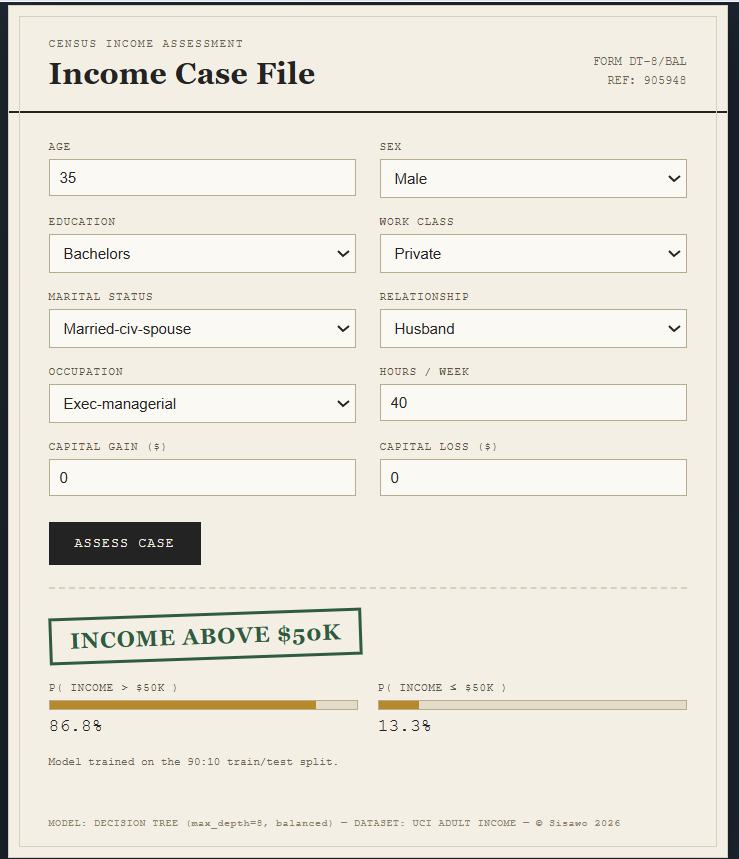

# Adult Income Classifier

[](https://www.python.org)
[](https://fastapi.tiangolo.com)
[](https://scikit-learn.org)
[](LICENSE)
[](#status)
[](https://archive.ics.uci.edu/ml/datasets/adult)
[](https://github.com/AbdouSalamSisawo/adult-income-classifier/stargazers)

A stateless **FastAPI backend** + **static HTML/JS frontend** for predicting whether an individual's annual income exceeds $50,000 based on the UCI Adult Income dataset. Trained using a Decision Tree classifier with feature engineering and preprocessing. No database, no server-side storage — every prediction request is processed independently and returned in milliseconds.



## Overview

This project demonstrates a complete machine learning pipeline from data exploration to deployment:

- **ML Phase**: a Jupyter notebook covering EDA, cleaning, feature engineering, and training/comparing a Decision Tree and Naïve Bayes across five train/test splits
- **Production Phase**: FastAPI backend + vanilla JavaScript frontend with instant predictions

## Tech Stack

### Backend
- **FastAPI** 0.104.1 — web framework
- **Uvicorn** 0.24.0 — ASGI server
- **Scikit-learn** 1.8.0 — preprocessing and inference (must match the version the model was trained with)
- **Pandas** 2.1.3 / **NumPy** 1.26.2 — feature row construction
- **Pydantic** 2.5.0 — request/response validation

### Frontend
- **Vanilla JavaScript**, **HTML5 + CSS3** — single static page, no build step
- Form options are loaded from the backend's `/schema` endpoint, so they always match the model

### Training & Data
- **Jupyter Notebook** — exploratory data analysis and model development
- **UCI Adult Income Dataset** — 48,842 records (32,561 train + 16,281 test), 14 attributes

## Features

✅ **Instant Predictions** — sub-100ms response times
✅ **Fully offline** — no external APIs
✅ **Interactive Web UI** — case-file style interface
✅ **REST API** — OpenAPI/Swagger documentation at `/docs`
✅ **Faithful preprocessing** — caps, encodings and column order are read from the trained model artifact
✅ **CORS Enabled** — frontend can be hosted separately
✅ **Validated & tested** — Pydantic input validation, logged server errors, pytest suite

## Project Structure

```
adult-income-classifier/
├── backend/                          # FastAPI prediction API
│   ├── main.py                       # FastAPI application & prediction endpoints
│   ├── adult_income_model.pkl        # Trained artifact (preprocessor + Decision Tree + metadata)
│   ├── requirements.txt              # Runtime dependencies
│   ├── requirements-dev.txt          # + test dependencies
│   ├── pytest.ini
│   └── tests/test_api.py             # API tests
│
├── frontend/
│   └── index.html                    # Single-page UI (form + results)
│
├── machine learning phase/           # ML research and development
│   ├── ML_model_notebook.ipynb       # Full pipeline; its last cell writes ../backend/adult_income_model.pkl
│   ├── Data/                         # UCI Adult dataset files (adult.data, adult.test, ...)
│   ├── Documents/                    # Assignment brief, rubric, report, slides
│   └── Readme.md                     # ML phase documentation
│
├── image.png                         # Screenshot of the interface
├── test_request.json                 # Sample API request
└── README.md
```

## Installation

### Prerequisites
- **Python 3.11 or 3.12** (scikit-learn 1.8 requires ≥ 3.11; the pinned pandas/NumPy have no 3.13 wheels)
- A modern web browser

### Setup

```bash
git clone https://github.com/AbdouSalamSisawo/adult-income-classifier.git
cd adult-income-classifier

python -m venv .venv
# Windows:  .venv\Scripts\activate
# macOS/Linux: source .venv/bin/activate

pip install -r backend/requirements.txt
```

> Use a virtual environment. Installing into your global Python lets other packages
> (e.g. anything requiring NumPy 2) silently upgrade NumPy and break pandas/scikit-learn.

## Running Locally

Use **two terminals** (both with the venv activated).

**Terminal 1 — backend API**
```bash
cd backend
python -m uvicorn main:app --host 0.0.0.0 --port 8000
```
- API: http://localhost:8000
- Swagger docs: http://localhost:8000/docs
- ReDoc: http://localhost:8000/redoc

**Terminal 2 — frontend**
```bash
cd frontend
python -m http.server 8080
```

Open **http://localhost:8080**, fill in the form and click **Assess Case**.

### Example Prediction

The form defaults (Age 35, Private, Bachelors, Married-civ-spouse, Exec-managerial,
Husband, Male, 40 h/week, no capital gain/loss) give:
**Income > $50K** (86.75% probability).

## Running the Tests

```bash
cd backend
pip install -r requirements-dev.txt
python -m pytest
```

## API Endpoints

| Method | Path | Description |
|---|---|---|
| GET | `/` | Service info and training split |
| GET | `/health` | Liveness check |
| GET | `/schema` | Allowed values for every categorical field (used by the frontend) |
| POST | `/predict` | Make a prediction |
| GET | `/docs` | Swagger UI |

### POST `/predict`

**Request body** (camelCase or snake_case field names are both accepted):
```json
{
  "age": 42,
  "workclass": "Private",
  "education": "Bachelors",
  "maritalStatus": "Married-civ-spouse",
  "occupation": "Exec-managerial",
  "relationship": "Husband",
  "sex": "Male",
  "capitalGain": 0,
  "capitalLoss": 0,
  "hoursPerWeek": 45
}
```

**Response:**
```json
{
  "prediction": ">50K",
  "prediction_label": 1,
  "probability_above_50k": 0.8675,
  "probability_at_or_below_50k": 0.1325,
  "model_trained_on_split": "90:10"
}
```

**Status codes:** `200` success · `422` invalid input (details per field) · `500` internal error (logged server-side).

## Model Details

### Algorithm
- **Decision Tree Classifier** (`max_depth=8`, `class_weight='balanced'`, `random_state=42`)
- Best of five train/test splits (50:50 → 90:10); the deployed model uses **90:10**

### Features (41 model inputs)
- **Continuous (MinMax-scaled)**: age, education-num, capital-gain, capital-loss, hours-per-week
- **Label-encoded**: sex (Female=0, Male=1)
- **One-hot encoded**: workclass, marital-status, occupation, relationship
- Not used by the model: race, native-country, fnlwgt, and the `education` label (redundant with education-num)

### Preprocessing
- Missing values (`?`) imputed with the mode
- **Winsorisation** of capital-gain / capital-loss at the 99th percentile (15,024 / 2,001)
- **MinMax scaling** of continuous features, fitted on the training split only

### Performance (90:10 test split)
| Metric | Decision Tree | Naïve Bayes |
|---|---|---|
| Accuracy | 0.8149 | 0.7206 |
| Precision (>50K) | 0.5778 | 0.4578 |
| Recall (>50K) | 0.8425 | 0.9050 |
| F1 (>50K) | **0.6855** | 0.6080 |

Model artifact size: ~30 KB.

## How the model input is reconstructed

`adult_income_model.pkl` is a dict written by the notebook's final cell:

| Key | Contents |
|---|---|
| `preprocessor` | fitted `ColumnTransformer` (MinMax on 5 continuous columns, passthrough for 36 encoded columns) |
| `model` | fitted `DecisionTreeClassifier` |
| `split` | training split label (`"90:10"`) |
| `winsor_caps` | capital-gain / capital-loss caps |
| `education_num_map` | education label → education-num |
| `sklearn_version` | scikit-learn version used for training |

`backend/main.py` derives the column order and the allowed category values from
`preprocessor.feature_names_in_`, and the caps / education mapping from the
artifact itself. Retraining therefore never requires editing the backend. Just
re-run the notebook and restart the API. The API refuses to start if the
installed scikit-learn version differs from the one the model was pickled with.

## Retraining the Model

```bash
pip install jupyter matplotlib seaborn
cd "machine learning phase"
jupyter notebook ML_model_notebook.ipynb   # Run All
```
The last cell overwrites `backend/adult_income_model.pkl`. If you change the
scikit-learn version, update `backend/requirements.txt` to match.

## Deployment

- **Backend**: any Python host (Render, Railway, Fly.io, a VPS, …). Ship
  `adult_income_model.pkl` alongside `main.py` and use Python 3.11/3.12.
- **Frontend**: any static host (Vercel, Netlify, GitHub Pages). Point it at your
  backend by setting `window.BACKEND_URL` before the main script, or by editing the
  `BACKEND_URL` constant in `frontend/index.html`.

## Troubleshooting

| Symptom | Cause / Fix |
|---|---|
| `pip install` fails building NumPy | Unsupported Python version. Use 3.11 or 3.12. |
| API won't start: `InconsistentVersionWarning` | Installed scikit-learn ≠ training version. `pip install -r backend/requirements.txt` in a fresh venv. |
| Frontend says "Cannot reach the backend" | Start the backend on port 8000, then reload the page. |
| Port already in use | Windows: `netstat -ano \| findstr :8000`; or pick another port. |
| `numpy.dtype size changed` errors | NumPy was upgraded underneath pandas, typically in a shared global environment. Use a venv. |

## Credits & Attribution

- **Dataset**: UCI Machine Learning Repository — Adult Income Dataset
- **Framework**: FastAPI and vanilla JavaScript
- **Training**: scikit-learn Decision Tree classifier
- **Design inspiration**: retro government form aesthetic

## License

MIT License. See [LICENSE](LICENSE).
